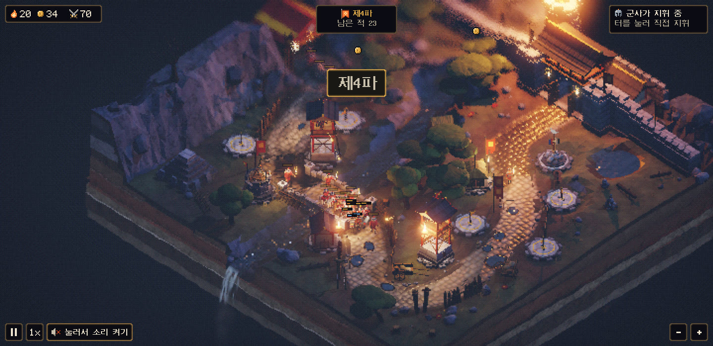
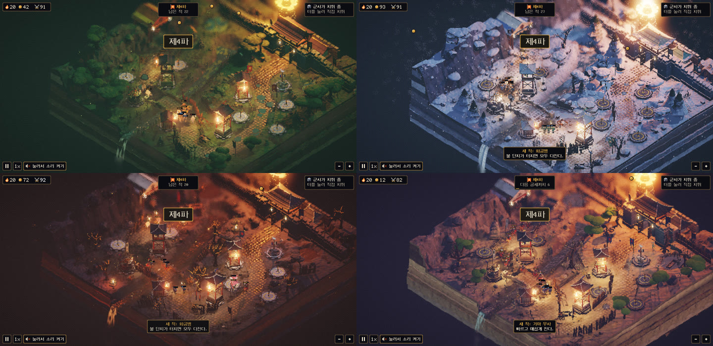

# 조선워치 (Chosunwatch)

**봉화를 지켜라.** 산성 꼭대기의 봉수대를 향해 밀려오는 침공군을 망루·포차·솟대·초소로 막아 내는, 스스로 플레이되는 3D 아이소메트릭 타워 디펜스입니다. HTML 파일 하나로 돌아갑니다.

살수(612)에서 행주산성(1593)까지, 한국사의 네 전쟁이 남긴 다섯 승전의 전장을 연대순으로 지나갑니다. 페이지를 열면 군사(軍師)가 알아서 싸우고, 언제든 직접 지휘를 넘겨받을 수 있습니다.

**[브라우저에서 바로 플레이](https://namojo.github.io/chosunwatch/)**



> 이 게임은 [kevintngo/cinderwatch](https://github.com/kevintngo/cinderwatch)(MIT)를 한국사 테마로 리노베이션한 작품입니다. 엔진·메커니즘·밸런스는 원작의 것이고, 전장·적군·타워·글자·소리를 새로 만들었습니다.

## 다섯 전장

| 전장 | 연도 | 지키는 쪽 | 쳐들어오는 쪽 | 적장 |
| --- | --- | --- | --- | --- |
| **살수** · 살수대첩 | 612 | 고구려 | 수나라군 | 우중문 |
| **안시성** · 안시성 전투 | 645 | 고구려 | 당나라군 | 이세적, 설인귀 |
| **귀주성** · 귀주성 전투 | 1231 | 고려 | 몽골군 | 살리타이 |
| **진주성** · 진주대첩 | 1592 | 조선 | 왜군 | 호소카와 다다오키 |
| **행주산성** · 행주대첩 | 1593 | 조선 | 왜군 | 우키타 히데이에 |

다섯 번째 공세마다 적장이 나타납니다. 적장을 물리치면 전장이 무너져 내리고, 어둠 속에서 다음 시대의 전장이 솟아오릅니다.



## 무엇이 들어 있나

- **타워 넷, 각 세 단계.** 시대에 따라 이름과 모습이 달라집니다.

  | | 고구려 | 고려 | 조선 | 역할 |
  | --- | --- | --- | --- | --- |
  | 궁수 | 맥궁 망루 | 각궁 망루 | 편전 망루 | 빠른 불화살. 나는 적도 맞힌다. |
  | 포 | 포차 | 포차 | 총통 포대 | 느리지만 터지는 탄. 땅의 적만. |
  | 솟대 | 벼락 솟대 | 벼락 솟대 | 벼락 솟대 | 적 사이를 튀는 벼락. 발을 묶는다. |
  | 초소 | 창병 초소 | 별초 초소 | 의병 초소 | 길을 막고 싸우는 병사들. |

- **스무 가지가 넘는 병종.** 보졸과 척후병, 화살을 튕겨 내는 중갑병, 말 탄 경기병, 다칠수록 빨라지는 결사대, 초소를 빠져나가는 세작, 연막 속으로 사라지는 자객, 주변을 재촉하는 전고수, 증원을 부르는 독전관, 부서지면 병사가 쏟아지는 충차·운제·누차, 하늘의 전투매·풍등·대연 척후. 같은 병종도 군대에 따라 아시가루, 사무라이, 닌자, 명광개 갑사, 송골매처럼 이름과 차림이 바뀝니다.
- **불빛이 주인공.** 일렁이는 봉화, 망루마다의 횃불, 불화살과 포연, 벼락. 그림자가 함께 움직입니다.
- **에셋 파일 0개.** 모델, 질감, 소리, 음악, 한글 글꼴까지 전부 코드와 빌드로 만듭니다.
- **국악풍 생성 음악.** 전장마다 다른 음계의 선율과, 싸움이 거세질수록 빨라지는 장단.

## 조작

아무것도 누르지 않아도 게임은 진행됩니다. 첫 명령을 내리는 순간 직접 지휘가 시작되고, 다시 맡길 때까지 군사는 물러나 있습니다.

| 입력 | 동작 |
| --- | --- |
| 빈 터 클릭/탭 | 건설 메뉴 |
| 타워 클릭/탭 | 증축 또는 철거 |
| `1` ~ `4` | 타워 종류 고르기 |
| `U` / `X` | 증축 / 철거(두 번 눌러 확인) |
| `Space` | 다음 공세를 일찍 부르기 |
| `C` 또는 지휘 판 클릭 | 군사에게 맡기기 / 넘겨받기 |
| `P` / `Tab` / `M` | 일시 정지 / 배속(1·2·3배) / 소리 |
| 휠·핀치, `+` `-` | 확대·축소 |
| 드래그, 방향키, `W` `A` `S` `D` | 시점 이동 |
| `F` 또는 `0` | 전투 따라가기 |

휴대폰과 태블릿에서는 세로·가로 모두 지원합니다. 브라우저 정책상 소리는 첫 클릭·탭·키 입력 뒤에 켜집니다.

## 실행과 빌드

`index.html`을 열면 됩니다. 서버도, 빌드도, 네트워크도 필요 없습니다(`file://`에서 동작).

```bash
python3 tools/build.py
```

`src/*.js`를 이어 붙이고 `vendor/`의 three.js를 넣어 `index.html`을 만듭니다. 소스에 쓰인 한글만 골라 픽셀 글꼴 데이터로 내장하는 단계가 포함됩니다.

URL 플래그 예: `index.html#seed=4&biome=gwiju`

| 플래그 | 효과 |
| --- | --- |
| `seed=N` | 전장 생성과 진행을 고정 |
| `biome=salsu\|ansi\|gwiju\|jinju\|haengju` | 시작 전장 |
| `level=N`, `k=N` | 뒤쪽 전장·공세에서 시작 |
| `ff=S` | 첫 화면 전에 S초 빨리감기 |
| `fps=1` | 프레임률과 드로콜 표시 |

## 고증에 대하여

다섯 전장은 모두 수비 측이 실제로 승리한 전투이고, 연도·인물·병종 이름은 통설을 따랐습니다. 다만 이것은 게임입니다. 벼락을 부르는 솟대, 하늘을 나는 풍등과 대연 척후, 거대한 적장은 민속과 상상에서 빌려 온 게임적 허용이고, 한 전장에 여러 병종이 뒤섞여 나오는 것도 원작의 메커니즘을 그대로 옮긴 결과입니다. 검수 기록은 [`_workspace/01_lore_review.md`](_workspace/01_lore_review.md)에 있습니다.

## 이 저장소는 에이전트 하네스로 만들어졌습니다

리노베이션은 `.claude/` 아래의 에이전트 팀이 수행했고, 같은 하네스로 계속 고치고 확장할 수 있습니다.

```
[계약·고증] ──▶ [병렬 제작 ×5] ──▶ [병합] ──▶ [통합 QA] ──▶ [배포]
 lore-historian   battlefield-artisan            qa-playtester
                  army-modeler                        │
                  tower-architect       ◀── 결함 재작업 루프 ──┘
                  hud-calligrapher
                  gugak-composer
```

| 경로 | 내용 |
| --- | --- |
| `CLAUDE.md` | 하네스 진입점과 핵심 계약 |
| `.claude/agents/` | 일곱 역할의 에이전트 정의 |
| `.claude/skills/chosun-renovate/` | 오케스트레이터(단계, 팀 편성, 병합, QA 루프, 배포) |
| `.claude/skills/chosun-world-bible/` | 세계관·고증·이름·색 계약 |
| `.claude/skills/cinder-engine-guide/` | 엔진 구조와 절차적 모델링 API, 파일 소유권 |
| `.claude/skills/hangul-pixel-font/`, `gugak-synth/`, `playtest-qa/`, `pages-deploy/` | 역할별 작업 방법 |
| `_workspace/` | 에이전트 보고서, 핸드오프, QA 기록 |

Claude Code에서 이 저장소를 열고 "귀주성을 더 춥게 만들어 줘", "명량 전장을 추가해 줘", "QA 돌리고 다시 배포해 줘"처럼 요청하면 오케스트레이터 스킬이 해당 에이전트를 불러 작업합니다.

## 소스 구조

| 경로 | 내용 |
| --- | --- |
| `index.html` | 빌드된 게임 |
| `src/05-lore.js` | 시대·군대 색, 이름 조회 |
| `src/29-biome.js` ~ `33-flora.js`, `41-weather.js` | 다섯 전장: 팔레트, 지형, 성곽과 봉수대, 식생, 날씨 |
| `src/50-rig.js`, `51-bestiary.js`, `61-monsters.js`, `62-game.js` | 침공군 모델과 리그, 병종 정의, 공세와 군사(AI) |
| `src/52-allies.js`, `60-towers.js` | 수비 병사, 타워 |
| `src/70-pixelfont.js`, `71-hangul-data.js`, `72-ui.js` | 픽셀 글꼴과 한글 글리프, HUD·메뉴·입력 |
| `src/80-audio.js` | 합성 사운드와 생성 음악 |
| `src/00-util.js`, `10-gfx.js`, `20-post.js`, `40-fx.js`, `90-main.js` | 수학, 질감·재질, 렌더러·후처리, 조명·파티클, 카메라·메인 루프 |
| `tools/` | 빌드 스크립트, 헤드리스 테스트 도구 |

## 라이선스

[MIT](LICENSE). 원작 [Cinderwatch](https://github.com/kevintngo/cinderwatch) © kevintngo (MIT). 빌드에는 [three.js](https://threejs.org) r170(MIT, [고지](vendor/LICENSE-three.txt))과 [GNU Unifont](https://unifoundry.com/unifont/)에서 뽑은 한글 글리프(SIL OFL 1.1, [고지](vendor/LICENSE-unifont.txt))가 포함됩니다.
